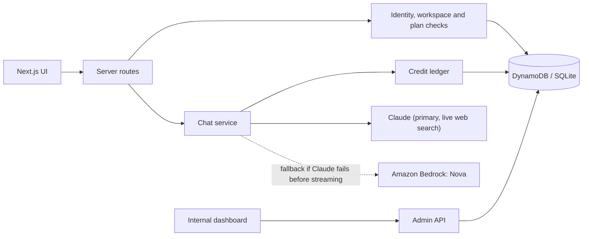

<div align="center">

# ARIA

**AI chat for individuals and teams — with workspaces, saved conversations and transparent usage accounting.**


</div>

ARIA is a Next.js application from [The Binary Holdings](https://github.com/The-Binary-Holdings). It gives people one chat experience backed by Claude (with Amazon Nova on Bedrock as a fallback), and gives operators an internal console to watch usage and manage access. The server owns identity, workspace access, plan rules and credit accounting. The browser can never grant itself permissions or credits.

> **Status:** ARIA is under active development on [`Aria-new-setup`](https://github.com/The-Binary-Holdings/Aria/tree/Aria-new-setup). Local development works without AWS. Production chat stays disabled until the required AWS services are configured and verified in staging, so the application is not ready for a public launch.

## Contents

- [Features](#features)
- [Architecture](#architecture)
- [Quick start](#quick-start)
- [Configuration](#configuration)
- [Internal dashboard](#internal-dashboard)
- [Plans and credits](#plans-and-credits)
- [Development](#development)
- [Deployment](#deployment)
- [Project structure](#project-structure)
- [Roadmap](#roadmap)
- [Documentation](#documentation)

## Features

| Area | What you get |
| --- | --- |
| **Chat** | Streaming answers, a versioned server-owned system prompt, saved conversations, chat export as JSON, and a clear notice when a reply reaches the output limit. |
| **Live web search** | When Claude is configured, it searches the web by itself, up to a per-message limit, only when a question needs current facts. Answers link the sources they rely on, and each search is metered. |
| **Projects** | Create, rename and delete projects, start a chat inside one, and move chats between projects. |
| **Workspaces** | Personal and Team workspaces with owner, admin and member roles, invitations, seat limits and per-member monthly credit limits. |
| **Accounts** | Amazon Cognito sign-in and sign-up, email confirmation, password recovery, HttpOnly session cookies, session revocation, and profile name and photo. |
| **Plans** | Server-enforced Free, Pro and Team entitlements for credits, seats and features. Billing is not connected yet. |
| **Credits** | A shared ledger reserves credits before a request, settles on the tokens the provider reports, refunds failed requests and replays a completed retry without charging again. |
| **Internal dashboard** | An operator console with live usage analytics, customer and workspace tools, audited access controls and delegated operator roles. See [Internal dashboard](#internal-dashboard). |
| **Local development** | SQLite storage, a deterministic test model that exercises the real chat and credit path, and no AWS account needed. |

ARIA does **not** yet retrieve authorized business data, analyze uploaded files, take actions in other applications, issue public API keys or process subscription payments.

## Architecture



Before any model call the server checks the signed-in user, workspace membership, plan, rate limits and available credits. It reserves enough credits for the request in one transaction, then charges for the tokens the provider actually reports. Failed or incomplete requests release the hold, and a repeated completed request ID returns the saved answer instead of calling the model again.

**Model routing.** With `ANTHROPIC_API_KEY` set, chat uses Claude and falls back to Nova on Bedrock if Claude fails before it starts streaming. Reservations use Claude's higher rates. Without the key, chat uses Nova. In local development, a deterministic test model answers and no provider is called.

The [system prompt](lib/server/system-prompt.ts) asks for direct answers and honest handling of uncertainty and sources. It tells the model not to claim access to company data or live information the application has not supplied. Prompt quality should be re-checked for each model you configure; see [response quality checks](PROMPT_EVALUATION.md).

**Stack:** Next.js 16 App Router, React 19, TypeScript, OpenUI Agent Interface, Tailwind CSS 4, Radix UI, Amazon Cognito, DynamoDB (production) and SQLite via `node:sqlite` (local), the Anthropic SDK and Amazon Bedrock, and the Node test runner with `tsx`.

## Quick start

**Requirements:** Node.js 22.13 or newer (the Docker image uses Node 24) and npm.

```bash
git clone https://github.com/The-Binary-Holdings/Aria.git
cd Aria
git checkout Aria-new-setup
npm install
cp .env.example .env.local
```

Add these to `.env.local` to run entirely on your machine:

```bash
ARIA_LOCAL_DEV=true
ARIA_LIVE_CHAT=disabled
ARIA_ADMIN_LOCAL_DEV=true   # optional: lets the built-in local admin open /internal/
```

Start the app:

```bash
npm run dev
```

Open [http://127.0.0.1:3000/chat/](http://127.0.0.1:3000/chat/).

- **Default user.** Without signing in, local mode acts as the built-in test user *Alex Local*, who is also the local super admin when `ARIA_ADMIN_LOCAL_DEV=true`.
- **More accounts.** Create a customer at `/sign-up/`. For addresses ending in `@localhost.test`, the confirmation code is `424242`.
- **Data.** Accounts, credits, projects and chats persist in `.aria/local-dev.sqlite`, which is gitignored. Delete it to start fresh.
- **Chat.** Replies come from a deterministic test model and go through the normal credit ledger, so nothing calls a provider or spends money.
- **Plans.** Set `ARIA_PLAN_SWITCHING=enabled` to let workspace owners change plans from the pricing page. Never enable it in production, where plans should change only through verified billing events.
- **Design preview.** `NEXT_PUBLIC_ARIA_PREVIEW=true` serves a static interface with scripted replies and no server data.

## Configuration

Copy [`.env.example`](.env.example) to `.env.local`. It documents every variable and the staging and production checklist. Never put secrets in `NEXT_PUBLIC_*` variables.

| Group | Variables | Notes |
| --- | --- | --- |
| **Identity** | `ARIA_COGNITO_USER_POOL_ID`, `ARIA_COGNITO_CLIENT_ID`, `ARIA_COGNITO_CLIENT_SECRET`, `ARIA_APP_ORIGIN` | Required in production. `ARIA_APP_ORIGIN` is the canonical HTTPS origin used for cross-site request checks and invite links. |
| **Data** | `ARIA_DYNAMODB_TABLE`, `ARIA_DYNAMODB_ENDPOINT` | The table is required in production; omit it locally to use SQLite. The endpoint is for DynamoDB Local in development only. |
| **Claude** | `ANTHROPIC_API_KEY`, `ANTHROPIC_MODEL_ID`, `ANTHROPIC_WEB_SEARCH_MAX_USES`, `ANTHROPIC_INPUT_USD_PER_MILLION`, `ANTHROPIC_OUTPUT_USD_PER_MILLION` | The key enables Claude. The model defaults to `claude-opus-5-5`; `claude-haiku-5-5` is a low-cost choice for development. Search runs 0–5 times per message and defaults to 2. |
| **Bedrock (Nova)** | `AWS_REGION`, `AWS_BEARER_TOKEN_BEDROCK`, `ARIA_NOVA_MODEL_ID`, `ARIA_NOVA_INPUT_USD_PER_MILLION`, `ARIA_NOVA_OUTPUT_USD_PER_MILLION`, `ARIA_RATE_VERSION` | Fallback model, or the primary one when Claude is not configured. Rates must match the model you choose. |
| **Switches** | `ARIA_LIVE_CHAT`, `ARIA_PLAN_SWITCHING`, `NEXT_PUBLIC_ARIA_PREVIEW` | `ARIA_LIVE_CHAT=enabled` is the operator switch for production model calls. |
| **Internal access** | `ARIA_ADMIN_SUBS`, `ARIA_ADMIN_ROLES`, `ARIA_ADMIN_EMAILS`, `ARIA_ADMIN_LOCAL_DEV` | See [Internal dashboard](#internal-dashboard). `ARIA_ADMIN_EMAILS` and `ARIA_ADMIN_LOCAL_DEV` work in development only. |
| **Email** | `EMAIL_SERVICE_URL`, `EMAIL_SERVICE_API_KEY` | OneWave service for Team invitations. Without it, admins get a one-time link to share. See [Team email setup](TEAM_EMAIL_SETUP.md). |
| **Optional search** | `ARIA_SEARXNG_URL`, `ARIA_ELASTICACHE_URL` | Server-side SearXNG support and a private cache for public results. See [SearXNG setup](SEARXNG_SETUP.md) and [ElastiCache setup](ELASTICACHE_SETUP.md). |

Without the required configuration, the production chat API returns `503` by design.

## Internal dashboard

The operator console lives at `/internal/`, with a dedicated sign-in at `/internal/sign-in/`. Operators who are signed in to ARIA also see **Internal dashboard** in the workspace user menu. The server tells the browser someone is an operator only when they are, and every admin route re-verifies access.

- **Overview.** Platform totals, live usage analytics (requests, tokens, credits and active users over 7, 30 or 90 days, top users and usage by plan), plan distribution, and a customer search.
- **Customers and plans.** Customer and workspace profiles, plan and credit visibility, and Pro and Team pricing copy.
- **Controls.** Change a plan, grant small credit adjustments, suspend or restore ARIA AI for a customer, and revoke sessions. Every action is audited.
- **Live sync.** A change made in the console reaches an open workspace within about 15 seconds. The usage view refreshes every 30 seconds.
- **Delegation.** Only super admins can change everything. A super admin can give a teammate a scoped role from **Admin → Operators**, tied to that person's verified email:

| Role | Can do |
| --- | --- |
| **Super admin** | Everything, including managing operators. Set on the server through `ARIA_ADMIN_SUBS`. |
| **Support** | View only. |
| **Billing** | View, change plans and grant small credit adjustments. |
| **Operations** | View, suspend or restore AI access, and revoke sessions. |

Locally, set `ARIA_LOCAL_DEV=true` and `ARIA_ADMIN_LOCAL_DEV=true` and the built-in Alex user is a super admin. For production setup, access rules and the existing-account index, see [Internal dashboard setup](INTERNAL_ADMIN_SETUP.md).

## Plans and credits

Plan rules live on the server in [`lib/server/accounts/entitlements.ts`](lib/server/accounts/entitlements.ts). The allowances below are product proposals until payments are connected.

| Plan | Monthly credits | Seats | Longest answer | Notes |
| --- | ---: | ---: | ---: | --- |
| **Free** | 200 | 1 | 2,048 tokens | |
| **Pro** | 6,000 | 1 | 4,096 tokens | API-access entitlement |
| **Team** | 20,000 shared | 5 | 4,096 tokens | Team management and per-member limits |

Pro and Team carry an API-access entitlement, but ARIA does not issue API keys or expose a public developer API yet. In a Team workspace, owners and admins can set a monthly credit limit per member under **Settings → Team**. Each request must fit both the member's allowance and the shared pool, and limits carry into the next UTC month while used credits reset.

## Development

| Command | Purpose |
| --- | --- |
| `npm run dev` | Start the development server on `127.0.0.1:3000` |
| `npm test` | Run the automated test suite |
| `npm run typecheck` | Check TypeScript |
| `npm run lint` | Run ESLint |
| `npm run build` | Build the standalone production bundle |
| `npm start` | Run the built application |
| `npm run admin` | Operator commands such as plan changes and reconciliation |
| `npm run admin:backfill` | Add dashboard index keys to a pre-existing DynamoDB table |

The tests cover authorization boundaries, concurrent credit spending, retries, crash reconciliation, persistence, project assignment, Team invitations and limits, profile editing, operator delegation and usage analytics. Real Cognito, DynamoDB, Bedrock, Anthropic and OneWave behavior still needs staging verification. ESLint currently reports some findings in the internal dashboard code that are being cleaned up.

## Deployment

The repository includes a multi-stage [`Dockerfile`](Dockerfile) (Node 24, standalone Next.js output, non-root user) and a [`buildspec.yml`](buildspec.yml) that builds the image, pushes it to Amazon ECR and writes an `imagedefinitions.json` for ECS. Runtime configuration comes from the ECS task definition, not from the build.

Production needs a Cognito user pool and app client, a DynamoDB table ([definition](infra/dynamodb-table.json)), a canonical application origin and the `ARIA_LIVE_CHAT=enabled` switch, plus an Anthropic key or Bedrock model IDs with verified token rates. The [staging checklist](CODE_FIRST_PLAN.md#real-service-staging-checklist) lists the exact steps. ElastiCache is optional and only caches public search results; a private Valkey stack is in [`infra/elasticache-search.yaml`](infra/elasticache-search.yaml).

## Project structure

| Path | Purpose |
| --- | --- |
| `app/` | Pages, API routes (`app/api/`) and page styles |
| `app/internal/` | Internal dashboard page and its design system |
| `components/` | Chat, authentication, account, internal dashboard and shared UI |
| `lib/server/` | Identity, workspaces, credit ledger, model providers, admin and handlers |
| `lib/` | Client session, OpenUI integration and shared helpers |
| `hooks/` | Reusable React hooks |
| `infra/` | DynamoDB and ElastiCache definitions |
| `scripts/` | Build and operator tooling |
| `tests/` | Automated tests |
| `docs/` | Internal product requirements and prompt proposals |
| `emails/` | Email templates |

## Roadmap

ARIA still needs server-owned library and personalization, chat search and pagination, and retrieval from authorized sources with verifiable citations. After that come Pro and Team API keys and endpoints, subscription checkout with signed billing webhooks, and release-level browser, load, accessibility and security checks. Real AWS staging follows the code gate.

## Documentation

| Document | Covers |
| --- | --- |
| [Internal dashboard setup](INTERNAL_ADMIN_SETUP.md) | Operator access, roles and the existing-account index |
| [Internal PRD](docs/internal/prd.md) | Dashboard scope and acceptance criteria |
| [Team email setup](TEAM_EMAIL_SETUP.md) | OneWave invitation emails |
| [ElastiCache setup](ELASTICACHE_SETUP.md) | Search cache deployment and fallback |
| [SearXNG setup](SEARXNG_SETUP.md) | Self-hosted public search |
| [Search research](SEARCH_TOOL_RESEARCH.md) | Why the search design looks the way it does |
| [Response quality checks](PROMPT_EVALUATION.md) | Evaluating prompt quality per model |
| [System prompt proposal](docs/system-prompt-proposal.md) | Prompt design notes |
| [Code-first plan](CODE_FIRST_PLAN.md) | Milestones and the release gate |
| [Implementation plan](IMPLEMENTATION_PLAN.md) | Infrastructure direction |
| [Product requirements](prd.md) | The broader product |
| [AWS pricing notes](aws-pricing-notes.md) | Cost assumptions |

---

Maintained by [The Binary Holdings](https://github.com/The-Binary-Holdings). Proprietary; all rights reserved unless the repository policy states otherwise.
