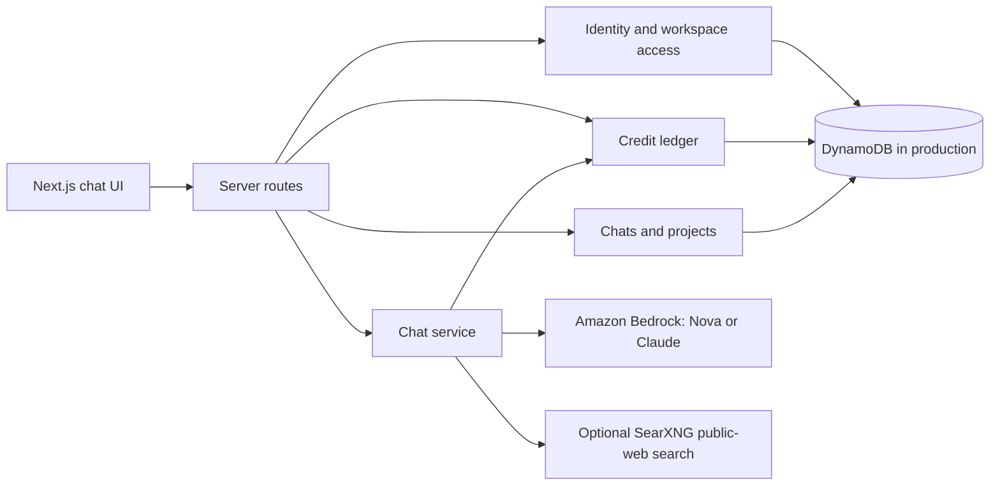

# ARIA

**AI chat for individuals and teams, with workspaces, saved conversations, and transparent usage accounting.**

ARIA is a Next.js application from The Binary Labs. It presents a single chat experience backed by Amazon Nova or Claude through Amazon Bedrock. The application owns identity, workspace access, plan rules, and credit accounting; the browser cannot grant itself permissions or credits.

> **Project status:** ARIA is under active development on [`Aria-new-setup`](https://github.com/The-Binary-Holdings/Aria/tree/Aria-new-setup). Local development works without AWS. Production chat is disabled until the required AWS services are configured and verified in staging. The application is not ready for a public launch.

## What works today

| Area | Current behavior |
| --- | --- |
| Accounts | Cognito sign-in and sign-up routes, email confirmation, password recovery, verified sessions in HttpOnly cookies, and session revocation. Users can edit their display name and profile photo in Account settings. A local identity provider supports development. |
| Workspaces | Personal and Team workspaces, owner/admin/member roles, invitations, seat limits, per-member monthly Team credit limits, and immediate access removal. Team invites are emailed through OneWave when configured, with a one-time link fallback for local setup. |
| Plans | Server-enforced Free, Pro, and Team entitlements for credits, seats, and available models. Billing is not connected. |
| Chat | Streaming responses through Bedrock when configured, a versioned server-owned system prompt, saved conversations, and an explicit notice when a response reaches the model's output limit. |
| Public web search | Optional, explicit SearXNG search from the chat composer. ARIA sends a short public query to the configured self-hosted instance, passes bounded snippets to the model, and saves linked search results with the answer. |
| Projects | Create, rename, and delete projects; start a chat inside a project; move chats between projects; filter the chat list by project. |
| Credits | A shared workspace ledger reserves credits before a request, settles using reported token usage, refunds failed requests, and replays completed retries without charging again. |
| Local development | Persistent SQLite data, two test users in separate workspaces, and a deterministic test model that exercises the normal chat and credit path. |

ARIA does **not** yet retrieve authorized business data, analyze uploaded files, take actions in other applications, issue public API keys, or process subscription payments. Public web search is separate from authorized workspace data.

## How it works



The server checks the signed-in user, workspace membership, plan, rate limits, and available credits before a model call. It reserves enough credits for the request in one transaction, then charges for actual provider-reported tokens. Failed or incomplete requests release the customer hold. A repeated completed request ID returns the saved answer rather than invoking the model again.

The [ARIA system prompt](lib/server/system-prompt.ts) asks for direct, useful answers and honest handling of uncertainty and sources. It tells the model not to claim access to company data or live information that the application has not supplied. A web search supplies snippets and URLs, not the full pages. Prompt quality still needs evaluation with each configured Bedrock model; see [response quality checks](PROMPT_EVALUATION.md).

## Technology

- **Application:** Next.js 16 App Router, React 19, TypeScript
- **Interface:** OpenUI Agent Interface, Tailwind CSS 4, Radix-based components
- **Identity:** Amazon Cognito with server-verified JWTs and HttpOnly cookies
- **Production data:** DynamoDB single-table design
- **Local data:** SQLite through `node:sqlite`; in-memory store for tests
- **Models:** Amazon Nova and Claude through Amazon Bedrock
- **Optional public search:** Self-hosted SearXNG JSON API
- **Tests:** Node test runner with `tsx`

## Run locally

**Requirements:** Node.js 22 or newer and npm. Node.js 26 is recommended.

```bash
git clone https://github.com/The-Binary-Holdings/Aria.git
cd Aria
git checkout Aria-new-setup
npm install
cp .env.example .env.local
```

Set `ARIA_LOCAL_DEV=true` in `.env.local`, then start the application:

```bash
npm run dev
```

Open [http://127.0.0.1:3000/sign-in/](http://127.0.0.1:3000/sign-in/). Sign in with a local test account, then open chat. The **Local user** control in the sidebar switches between Alex and Blair, whose workspaces are separate. Local chat uses a deterministic test model and the normal credit ledger; it does not call Bedrock or spend AWS credits.

In local development, the sidebar also has a **Test plan** control for Free, Pro, and Team. It changes the current workspace's server-owned plan and monthly credit allowance so you can test plan gates without checkout. A workspace with more than one occupied seat cannot switch to a one-seat plan until its extra members or pending invites are removed. This control is unavailable in production. The chat composer has no provider dropdown or plan label; ARIA chooses the default provider from the verified plan (Nova for Free, Claude for Pro and Team).

In a Team workspace, open **Settings → Team → Members → Set limit** to assign an individual monthly credit limit. Owners can set limits for admins or members; admins can set limits for members. Leave the field blank for no individual limit, or enter `0` to block that member's new usage. Each request must fit both the member's remaining allowance and the shared Team pool. Limits carry into the next UTC month while used credits reset. Lowering a limit below credits already used blocks new requests without reversing earlier charges. This applies to the chat ledger; public API access is not yet implemented.

Local accounts, credits, projects, and saved chats persist in `.aria/local-dev.sqlite`, which is gitignored. To try projects, open the chat sidebar, create and select a project, then send a message. Use a saved chat's **⋯ → Move to project** menu to reassign it or choose **No project**. The **Recents** menu can also export a chat as JSON.

Open **Profile → Account → Edit profile** to change your display name or photo. ARIA accepts PNG, JPEG, or WebP uploads up to 5 MB, crops the photo to a square, and saves a 128 × 128 PNG. The image is stored separately from the account record, so ordinary authenticated requests do not load it.

For a static interface preview with scripted replies and no server data, set `NEXT_PUBLIC_ARIA_PREVIEW=true` instead. Preview data is separate from authenticated workspace data and is not automatically migrated.

### Optional public web search

Run a private SearXNG instance with JSON responses enabled, then set its server-reachable base URL as `ARIA_SEARXNG_URL` in `.env.local` (for example, `http://127.0.0.1:8888`). Restart ARIA. The composer shows a **Web search** toggle when configured. Turn it on for a public question of up to 300 characters; do not include private documents, secrets, or customer data in that question. ARIA searches once, provides bounded snippets to the model, and appends clickable result links to the saved answer. If search fails or returns no usable results, no model call or credit charge occurs. See [SearXNG setup](SEARXNG_SETUP.md).

## Verify changes

```bash
npm test
npm run typecheck
npm run build
```

The current branch passes **71 automated tests**, type checking, and a production build. Tests cover authorization boundaries, concurrent credit spending, retries, crash reconciliation, persistence, project assignment, public search links, Team invitation email behavior, per-member Team limits, local plan switching, and profile editing. Local browser checks covered the profile upload/save/reload/remove flow at mobile width, plan switching, the prompt without a model control, project creation and assignment, moving a chat, the mobile sidebar, and viewport widths from 320 to 1440 pixels without horizontal overflow or page errors. Public search was also checked against a local mock SearXNG API. Real SearXNG and OneWave delivery remain to be tested in staging.

These checks do not verify real Cognito, DynamoDB, or Bedrock behavior. Those integrations require staging tests before production chat is enabled.

| Command | Purpose |
| --- | --- |
| `npm run dev` | Start the local development server |
| `npm test` | Run automated tests |
| `npm run typecheck` | Check TypeScript |
| `npm run build` | Build the production application and standalone bundle |
| `npm start` | Start the built application locally |
| `npm run admin` | Run operator commands such as plan changes and reconciliation |

## Plans and credits

Plan rules live on the server in [`lib/server/accounts/entitlements.ts`](lib/server/accounts/entitlements.ts). These allowances are product proposals until payments are connected:

| Plan | Included monthly credits | Seats | Models |
| --- | ---: | ---: | --- |
| Free | 200 | 1 | Nova |
| Pro | 6,000 | 1 | Nova and Claude |
| Team | 20,000 shared | 5 | Nova and Claude, plus team management |

Pro and Team include an API-access entitlement, but ARIA does **not** yet issue API keys or expose a public developer API. Subscription checkout and billing webhooks are also pending. An operator can change plans with `npm run admin -- set-plan` during development and staging.

### Team invitation email

Set `EMAIL_SERVICE_URL` and `EMAIL_SERVICE_API_KEY` on the ARIA server to use the OneWave email service integrated in `aria-api-changes`. Configure its `aria-team-invitation` template to use `name`, `expiry_days`, and `invite_link`, and set `ARIA_APP_ORIGIN` to the public HTTPS ARIA origin. When an owner or admin invites a Team member, ARIA creates a seven-day, single-use invitation, sends the link to the invited email, and shows a delivery confirmation without exposing the link in the API response. If delivery fails, ARIA revokes the invitation and releases its reserved seat. Without email configuration, the existing one-time link is shown to the admin for manual sharing. See [Team email setup](TEAM_EMAIL_SETUP.md).

## Production requirements

Production accounts and saved work require a Cognito user pool and app client, a DynamoDB table, and a canonical application origin for cross-site request checks. Live model calls also require Bedrock model IDs, verified token rates, AWS permissions, and the explicit `ARIA_LIVE_CHAT=enabled` switch. See [`.env.example`](.env.example), the [DynamoDB table definition](infra/dynamodb-table.json), and the [staging checklist](CURSOR_HANDOFF.md) for the exact configuration.

Without the required configuration, the production chat API returns `503` by design. Do not put AWS credentials or Cognito secrets in `NEXT_PUBLIC_*` variables. AWS provisioning and real-service staging tests have not been completed.

## What remains before launch

The next code work is server-owned library and personalization, chat search and pagination, and a deliberate path for preview-only data. ARIA then needs authorized-source retrieval with verifiable citations, Pro/Team API keys and endpoints, subscription checkout and signed billing webhooks, and release-level browser, load, accessibility, and security checks. Real AWS staging and deployment follow the code gate.

Use the [code-first plan](CODE_FIRST_PLAN.md) for milestone order and the [Cursor handoff](CURSOR_HANDOFF.md) for verified behavior and the next exact task. The [product requirements](prd.md) and [implementation plan](IMPLEMENTATION_PLAN.md) describe the broader product and infrastructure direction.

## Repository guide

| Path | Purpose |
| --- | --- |
| `app/` | Pages, API routes, and application styles |
| `components/` | Chat, authentication, account, and shared UI |
| `lib/server/` | Identity, workspaces, credits, Bedrock, and server handlers |
| `lib/` | Client session and OpenUI integration |
| `tests/` | Access, ledger, chat, and local development tests |
| `infra/` | DynamoDB table definition |
| `scripts/` | Build and operator tooling |

ARIA is maintained by [The Binary Holdings](https://github.com/The-Binary-Holdings). Proprietary; all rights reserved unless the repository policy states otherwise.
