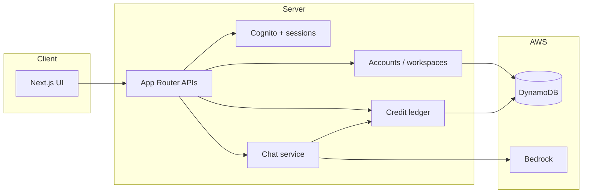

# ARIA

**A workspace-native AI chat for teams** — grounded answers, server-owned identity, and usage accounting designed for production.

ARIA is a Next.js application that pairs a polished chat experience (OpenUI + streaming) with **server-authoritative** workspaces, entitlements, and a shared credit ledger. Model calls run through **Amazon Bedrock** (Nova and Claude). Identity and billing state live on the server; the browser never defines plan, balance, or permissions.

> **Release status:** Application code is under active development on the `Aria-new-setup` branch. Local development and automated tests are supported today. Production chat remains **disabled by default** until Cognito, DynamoDB, Bedrock, and an explicit operator switch are configured and verified in staging. See [Production readiness](#production-readiness).

---

## Highlights

| Area | What you get |
| --- | --- |
| **Identity** | Amazon Cognito (password + refresh), HttpOnly session cookies, JWT verification, session revocation, CSRF on writes |
| **Workspaces** | Personal and team workspaces, roles (owner / admin / member), invitations, seat limits |
| **Entitlements** | Free, Pro, and Team plans enforced on the server (models, credits, API access) |
| **Ledger** | DynamoDB single-table design, atomic reservations, idempotent retries, crash reconciliation |
| **Chat** | AG-UI streaming, conservative holds, settlement on provider token usage |
| **Local dev** | Persistent SQLite store, two loopback users, deterministic fake model — no AWS required |

---

## Architecture



**Design principles**

- **Fail closed** — Unconfigured or unsigned requests do not reach model invocation.
- **One transaction per reservation** — Credits, membership, rate limits, and plan checks commit together.
- **Idempotent requests** — Safe retries reuse the same request ID without double charging.
- **No client authority** — Headers and UI state select context; they do not grant access or credits.

---

## Tech stack

- **Framework:** [Next.js](https://nextjs.org/) 16 (App Router, standalone output)
- **UI:** React 19, Tailwind CSS 4, Radix / shadcn-style components, [OpenUI](https://www.openui.com/) Agent Interface
- **Auth:** Amazon Cognito, `aws-jwt-verify`
- **Data:** DynamoDB (production), SQLite via Node `node:sqlite` (local persistence), in-memory store (tests)
- **Models:** Amazon Bedrock (Nova, Claude) through a single chat pipeline
- **Tests:** Node test runner + `tsx`

---

## Quick start (local development)

**Requirements:** Node.js 22+ (26 recommended), npm

```bash
git clone https://github.com/The-Binary-Holdings/Aria.git
cd Aria
git checkout Aria-new-setup
npm install
cp .env.example .env.local
```

In `.env.local`, set:

```env
ARIA_LOCAL_DEV=true
```

Start the dev server:

```bash
npm run dev
```

Open [http://127.0.0.1:3000/sign-in/](http://127.0.0.1:3000/sign-in/). In local mode you can sign in with any email and password. Use the **Local user** control in the chat sidebar to switch between **Alex** and **Blair** (separate workspaces). Chat uses a **deterministic test model** and the real ledger path — not Bedrock.

Workspace data and credits persist under `.aria/local-dev.sqlite` (gitignored) across restarts.

### Design preview (no server)

For static UI review with scripted replies and no API:

```env
NEXT_PUBLIC_ARIA_PREVIEW=true
```

---

## Scripts

| Command | Purpose |
| --- | --- |
| `npm run dev` | Development server (loopback) |
| `npm run build` | Production build + standalone bundle |
| `npm start` | Run production server locally |
| `npm test` | Unit and integration tests |
| `npm run typecheck` | TypeScript check |
| `npm run admin` | Operator CLI (`set-plan`, `reconcile`, `balance`, …) |

---

## Production readiness

Production chat and usage APIs require **all** of the following:

1. **Cognito** user pool and app client (`ARIA_COGNITO_*`)
2. **DynamoDB** table from [`infra/dynamodb-table.json`](infra/dynamodb-table.json) (`ARIA_DYNAMODB_TABLE`)
3. **Canonical origin** for CSRF (`ARIA_APP_ORIGIN`)
4. **Bedrock** model IDs and verified rates (`ARIA_NOVA_*`, `ARIA_CLAUDE_*`, `ARIA_RATE_VERSION`)
5. **Operator switch:** `ARIA_LIVE_CHAT=enabled` only after the staging checklist in [`CURSOR_HANDOFF.md`](CURSOR_HANDOFF.md) passes

Until then, `/api/chat/` returns **503** by design.

Never put AWS keys or Cognito secrets in `NEXT_PUBLIC_*` variables.

---

## Plans (server-defined)

Allowances are defined in `lib/server/accounts/entitlements.ts` and match the in-app pricing UI (**proposed** until billing is connected):

| Plan | Monthly credits | Seats | Models |
| --- | ---: | ---: | --- |
| Free | 200 | 1 | Nova |
| Pro | 6,000 | 1 | Nova + Claude |
| Team | 20,000 (shared) | 5 | Nova + Claude + team management |

---

## Repository layout

| Path | Description |
| --- | --- |
| `app/` | Routes, API handlers, global styles |
| `components/` | Chat shell, settings, auth forms, UI primitives |
| `lib/server/` | Auth, workspaces, ledger, Bedrock, handlers |
| `lib/` | Client session helpers, OpenUI integration |
| `tests/` | Ledger, access, chat, and local-dev tests |
| `infra/` | DynamoDB table definition |
| `scripts/` | Standalone build and admin tooling |
| `*.md` (root) | `IMPLEMENTATION_PLAN.md`, `CODE_FIRST_PLAN.md`, `CURSOR_HANDOFF.md`, `prd.md` |

---

## Documentation

| Document | Audience |
| --- | --- |
| [`CODE_FIRST_PLAN.md`](CODE_FIRST_PLAN.md) | Current engineering milestones (code before AWS) |
| [`CURSOR_HANDOFF.md`](CURSOR_HANDOFF.md) | Verified behavior, staging gate, operator setup |
| [`IMPLEMENTATION_PLAN.md`](IMPLEMENTATION_PLAN.md) | End-to-end product and infrastructure plan |
| [`prd.md`](prd.md) | Product requirements (proposed MVP) |
| [`AGENTS.md`](AGENTS.md) | Conventions for AI-assisted development (OpenUI) |
| [`.env.example`](.env.example) | Environment variable reference |

---

## Contributing

This repository is maintained by [The Binary Holdings](https://github.com/The-Binary-Holdings). For internal work, follow `CODE_FIRST_PLAN.md` milestone order and run `npm test`, `npm run typecheck`, and `npm run build` before opening a pull request.

---

## Author

**Gokulakrishnan96** — primary author ([`author.json`](author.json))

---

## License

Proprietary — The Binary Holdings. All rights reserved unless otherwise stated in repository policy.
