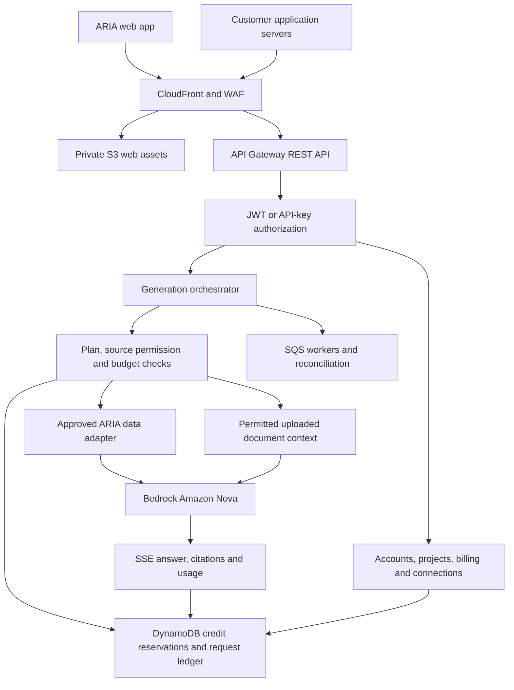

# ARIA Chat — Plans, Tokens, and Credits

> Implementation update, 20 October 2026: the actual frontend is **Next.js App Router + TypeScript + OpenUI**, with server routes and standalone Node output. The current model is **Amazon Nova via Bedrock** on every plan. Read `IMPLEMENTATION_PLAN.md` and `CURSOR_HANDOFF.md` for current implementation status and remaining production work. Older Vite/static-hosting references and cost examples below are historical proposals, not the current deployable architecture or launch budget.

Date: 20 October 2026  
Status: Proposed launch plan for 500 users; AWS architecture and cost estimates added. Retail prices and credit allowances below are proposals, not approved prices.

## 1. What we are building

ARIA Chat will have three plans: Free, Pro, and Team. Users spend credits when they use AI features. The system measures the underlying token and service usage and converts it into a credit charge.

The plan determines which features a user can access. The credit balance determines how much they can use those features. Data permissions determine which business information they can access.

This document updates the earlier MVP direction in prd.md: plans, credit accounting, paid subscriptions, and Team invitations are now in scope. Pricing and payment implementation still need to be selected.

## 2. The three plans

### Free — try ARIA

- A personal account with a limited recurring credit allowance.
- General chat for questions, writing, and explanations.
- Conversation history and a visible remaining-credit balance.
- No ARIA Intelligence access or Team administration.
- When credits run out, wait for the next allowance or upgrade.

### Pro — use ARIA Intelligence

- Everything in Free, plus access to ARIA Intelligence.
- Answers using authorized business data, with sources and limitations.
- A larger recurring personal credit allowance.
- A usage page showing credits spent and remaining.
- Developer API access for the member's own applications, using scoped API keys and the same personal credit balance as chat.
- Access to approved data must be provisioned separately. Paying for Pro does not automatically unlock every ARIA dataset.

If no business data is connected or approved, show a clear setup or access-request state. General chat remains available within the credit allowance.

### Team — use ARIA together

- Pro-level capabilities inside an organization workspace.
- An admin can invite teammates, remove members, and manage roles.
- An admin can configure the workspace's approved ARIA connection and assign access to members.
- Members can chat with ARIA using the sources they are permitted to access.
- A shared workspace credit pool, with usage visible to the admin.
- Optional per-member spending limits to control the shared budget.
- Workspace billing and subscription management.
- Workspace API access for the team's applications, with admin-managed project keys, source permissions, and spending caps.

Shared credits do not make conversations or uploaded files visible to every teammate. Conversations remain private to their author in the MVP; shared conversation collaboration is a later feature.

## 3. Tokens and credits, simply explained

**Tokens** are the units the underlying model processes. Input includes the user's message and any conversation context, instructions, or retrieved material sent to the model. Output is the model's generated response. Provider-reported usage may include other categories that need explicit accounting.

**Credits** are ARIA's user-facing usage balance. Users see credits instead of having to calculate raw token costs.

There is no fixed rule that one token equals one credit. Different models and services can have different rates. A short general question can cost fewer credits than a long answer involving business-data retrieval and several model calls.

Proposed calculation:

`credits charged = sum of metered usage × published credit rate for each usage category`

Usage categories may include input tokens, cached input tokens, output tokens, and approved ARIA service calls. Each unit and rate must be defined before launch. Categories must not overlap or double-count the same usage.

Aggregate all billable work for a user request, then round once according to the published credit precision. Store the rate version used for each charge. Do not introduce unlisted fees for internal operations.

Illustrative example only: if a request reserves 10 credits and finishes with an actual charge of 6 credits, release the remaining 4. These numbers do not define pricing.

## 4. Proposed credit rules

The following defaults are recommendations, not finalized commercial terms:

- Free credits renew monthly on a clearly displayed account renewal date.
- Pro and Team credits renew at the start of each paid billing period.
- Unused included credits expire at renewal; they do not roll over.
- Personal credits and Team credits are separate balances.
- A request uses the balance of the currently selected workspace. Never silently charge another balance.
- No automatic overage charges or negative balances in the MVP.
- Credit top-ups are a later feature. Initially, users renew or upgrade when they need more usage.
- Rate limits apply independently of credit balances to manage capacity and abuse.

Every balance should show its next renewal date. The application should warn users when credits are low and explain available options when exhausted.

## 5. How a request spends credits

1. Check the user's plan, workspace membership, requested feature, and data permissions.
2. Estimate a bounded maximum charge and reserve that amount from the correct credit balance.
3. If funds are insufficient, explain the issue before starting billable work.
4. Run the request within the reserved budget, including limits on output and tool calls.
5. Record actual usage and calculate the final credit charge.
6. Settle the charge and release unused reserved credits.
7. Show the final charge and updated balance in usage history.

Reservations must be atomic so simultaneous requests cannot overspend. A request that needs more budget must stop or obtain an additional authorized reservation before continuing.

### Failures, cancellation, and retries

- Rejected requests and permission failures before execution cost zero credits.
- A user stopping a response pays only for metered work already performed, under the displayed policy.
- System failures that produce no usable result release the reservation and refund any settled charge; ARIA absorbs upstream costs.
- A deliberately regenerated response is a new request and may consume credits.
- Automatic network retries must reuse the original request identifier and cannot create duplicate charges.
- If final usage is delayed or uncertain, mark the charge pending and reconcile it. Never guess a final charge or leave reservations locked indefinitely.

## 6. Team membership and ARIA connections

The person creating a Team becomes its Owner. Owners manage billing and ownership; Admins manage invitations, members, data connections, and spending limits; Members use permitted features and view their own usage.

Invitation flow:

1. Owner or Admin enters a teammate's email.
2. The system sends a single-use, expiring invitation.
3. The recipient signs in using the invited identity and accepts.
4. The teammate joins the workspace with the assigned role and permissions.
5. Requests in that workspace consume Team credits.

Invitations can be revoked. Enforce the configured member limit on acceptance, including simultaneous acceptances. Prevent removal of the last Owner without transferring ownership.

Connecting ARIA means configuring an authenticated service connection and approved dataset scope for the workspace. Credentials stay on the server. The upstream data owner must authorize access; an admin cannot grant access beyond that authorization.

Removing a member immediately blocks new workspace requests and access. Revoked source access also blocks subsequent retrieval. Historical chat and source-reference access must continue to respect current permissions.

## 7. Subscription changes

- **Free to Pro:** activate Pro after verified payment confirmation and grant the purchased allowance once.
- **Create or join Team:** create or join a separate Team workspace. Do not move personal conversations or credits automatically.
- **Renewal:** grant the new allowance once per billing period, even if payment notifications are delivered repeatedly.
- **Cancellation:** stop future renewals; retain paid access until the end of the paid period.
- **Pro expiry:** return the personal account to Free, remove Intelligence access, and apply the Free allowance without duplicate grants.
- **Team expiry:** disable new paid generation and new invitations. Preserve permitted read/export access according to retention policy; never merge Team data into personal accounts automatically.
- **Payment failure:** show a clear billing state. Do not grant a new paid allowance without confirmed payment; any grace period must be explicitly defined.

For the MVP, avoid automatic mid-period credit transfers or complicated prorations. Define the effective date and credit treatment on the checkout or plan-change screen before the user confirms.

## 8. Screens we need

- Plan selection: Free, Pro, Team, included features, prices, and allowances.
- Chat: selected workspace, available modes, remaining credits, low-balance alerts.
- Usage: request history, credit charges, pending charges, and renewal date.
- Billing: subscription status, payment details, renewal, and cancellation.
- Team settings: members, invitations, roles, credit pool, and member limits.
- ARIA connection settings: connection status, approved sources, and access scope.
- Developer settings: API keys, project scopes, API documentation, request usage, and spending caps. Available to Pro and Team only.

## 9. Build sequence

1. Build accounts, personal and Team workspace boundaries, and server-side feature permissions.
2. Build the credit ledger, reservations, settlement, renewal grants, and usage display.
3. Connect chat generation and measure actual usage against configured rates.
4. Add Pro billing and the approved ARIA Intelligence integration.
5. Add Team billing, invitations, roles, connections, and shared-credit controls.
6. Test access boundaries, billing events, concurrent requests, cancellations, refunds, and subscription expiry before release.

The ledger must record grants, reservations, charges, releases, refunds, and expirations with unique operation identifiers. Billing notifications must be authenticated and safe to process repeatedly. The browser cannot set its own plan, balance, or payment status.

## 10. Release checks

- Free users cannot call Intelligence through either the interface or API.
- Pro users only retrieve explicitly permitted business data.
- Team members cannot access another workspace's data or credits.
- Expired, revoked, or wrong-recipient invitations do not grant membership.
- Simultaneous requests cannot overspend the pool or member limit.
- Duplicate requests and billing events do not duplicate charges or grants.
- Stopping, retrying, provider failure, and application restart leave balances correct.
- The credit ledger reconciles with metered usage and billing periods.
- Renewal, cancellation, and expiry update feature access and balances consistently.

## 11. Decisions before launch

- Free credit allowance and renewal policy.
- Pro price and included credits.
- Team price, included credits, member limit, and whether pricing is per workspace or per seat.
- Credit rates for each model and ARIA operation, including minimum charge and rounding precision.
- File-upload limits and whether document processing consumes credits on each plan.
- Payment provider, supported currencies, and payment-failure grace period.
- Which ARIA service and datasets can actually be connected.

The sections below propose starting prices and an AWS implementation. Dataset access, commercial data licensing, payment support, and final launch-region costs must be confirmed before selling the plans.

## 12. Recommended technology stack

Build a modular TypeScript application on managed AWS services. Use one codebase with clear modules and a few independently deployed handlers: account/billing APIs, generation, and background workers. At 500 users, operational simplicity leaves more budget for product quality.

- **Web application:** React, TypeScript, Vite, Tailwind CSS, and accessible reusable components. Serve static assets from a private S3 bucket through CloudFront; no always-running frontend server is required.
- **Application APIs:** TypeScript on an AWS-supported Node.js LTS Lambda runtime, with schema validation and AWS SDK v3. Use API Gateway Regional REST API for both ordinary endpoints and streamed generation.
- **Streaming:** server-sent events (SSE), API Gateway response streaming, Lambda streaming, and Bedrock ConverseStream. Test the complete path through the CDN; disable caching and buffering for authenticated responses.
- **Models:** Amazon Nova through Amazon Bedrock. Start with Nova Micro for simple Free text requests, Nova Lite for standard work, and Nova Pro for evaluated complex tasks. Compare Nova 2 Lite on the evaluation set before promoting it; model names alone do not establish answer quality.
- **Authentication:** Amazon Cognito Essentials for email/password or supported social sign-in. Workspace membership and data permissions remain application-controlled.
- **Database:** DynamoDB on-demand for users, organizations, memberships, conversations, API projects, request state, and the credit ledger. Use transactions and conditional updates for balances. Store large message bodies and files in S3 rather than oversized database items.
- **Documents:** private S3, short-lived signed uploads, SQS ingestion queue, and a Lambda extraction worker for supported text documents. Begin with bounded document context and an existing ARIA retrieval service; defer a general vector database until retrieval benchmarks justify it.
- **Background tasks:** SQS with dead-letter queues and EventBridge Scheduler for reconciliation and maintenance. Subscription credit grants depend on verified billing events, not merely a scheduled date.
- **Secrets and security:** Secrets Manager, KMS where customer-managed keys are required, least-privilege IAM, AWS WAF, TLS, and CloudTrail.
- **Operations:** CloudWatch metrics/logs/alarms, sampled traces, AWS Budgets, and Cost Anomaly Detection. Configure log retention and redact customer payloads and credentials.
- **Deployment:** AWS CDK in TypeScript and GitHub Actions using OIDC to assume narrowly scoped AWS roles. Separate production and staging accounts; require tested deployments and rollback capability.
- **Payments:** integrate a subscription payment provider supported by the business's country and currency. Keep card handling in hosted checkout. The provider is not yet chosen, and its fees are outside the AWS estimate.

AWS currently documents response streaming for REST APIs, not HTTP APIs. Configure the Lambda proxy streaming integration explicitly; a normal buffered integration will not stream tokens. [AWS streaming documentation](https://docs.aws.amazon.com/apigateway/latest/developerguide/response-transfer-mode.html), [Lambda integration](https://docs.aws.amazon.com/apigateway/latest/developerguide/response-transfer-mode-lambda.html).

## 13. Architecture and request flow

This design applies established AI-platform practices: shared authorization, model routing, metered usage, isolated customer data, versioned APIs, and operational visibility. It does not claim to reproduce OpenAI's private internal architecture.

An ordinary general-chat request can go directly from policy checks to Bedrock without business-data retrieval. ARIA Intelligence requires a permitted source and validated evidence. Bedrock supplies the model; it does not provide ARIA's proprietary datasets.

Every request receives a request ID and a server-resolved workspace/project identity. After permission checks, reserve credit and concurrency capacity, retrieve approved context, call the chosen model, stream output, and settle actual usage. Bedrock returns usage metadata through ConverseStream; aggregate all model/tool calls belonging to the request. [ConverseStream reference](https://docs.aws.amazon.com/bedrock/latest/APIReference/API_runtime_ConverseStream.html).

Separate the **control path** (members, plans, keys, billing) from the **generation path** (permission checks, retrieval, inference, metering). They can share code libraries while using separate Lambda concurrency allocations so a burst of generations does not prevent billing or account recovery.

### Credit accounting and consistency

Use integer microcredits internally, an append-only ledger, and conditional transactions that reserve workspace, project, and member limits together. Preserve the billing-period ID and rate version on every reservation. A request crossing renewal settles against its original period; released expired credits do not become a new-period grant.

Persist application idempotency records for at least 24 hours, bound to the workspace, endpoint, and request-body hash. Reject the same key with a different payload. DynamoDB's transaction client token only covers a limited window, so it is not sufficient as the sole billing deduplication mechanism. [DynamoDB transactions](https://docs.aws.amazon.com/amazondynamodb/latest/developerguide/transaction-apis.html).

If a client disconnects, the server may still be running. Use request deadlines and explicit cancellation, then reconcile provider usage; a browser disconnect alone must not be treated as proof that inference stopped. A scheduled worker checks stale reservations using durable request state, settles known usage, and escalates uncertain cases without duplicate billing.

### Region and availability

Use one primary AWS region for launch. The cost model below uses **US East (N. Virginia), us-east-1**, as a pricing baseline, not permission to send customer data there. If launch customers require India residency, choose an approved region such as Mumbai only after checking model availability, inference destinations, and all service prices.

Cross-region inference can send model requests outside the application's region. A geography-wide profile is not equivalent to single-country residency. Use only destinations authorized by the data owner; never silently switch to a global profile to obtain a cheaper rate. [AWS cross-region inference](https://docs.aws.amazon.com/bedrock/latest/userguide/cross-region-inference.html).

Use the managed services' regional resilience, DynamoDB point-in-time recovery, S3 versioning/lifecycle rules, tested restore procedures, and documented incident response. Initial application availability target: 99.5% monthly, measured end to end. Proposed recovery objectives: restore within four hours and recover data to within fifteen minutes, validated by a restore drill before launch. These are internal targets, not a contractual SLA; single-region deployment does not guarantee continuity through a regional outage.

## 14. ARIA developer API for Pro and Team

Both paid plans can embed ARIA in their own applications. Free has no public developer API entitlement; the web app's internal endpoints remain authenticated and plan-limited.

### Initial API surface

- `POST /v1/responses` — generate a general or Intelligence response; support JSON and SSE output.
- `GET /v1/capabilities` — list permitted modes, model aliases, and source scopes.
- `GET /v1/usage` — retrieve the caller's permitted credit/token usage and balance.
- `GET /v1/requests/{id}` — inspect request status and billing state for retry recovery.
- `POST /v1/requests/{id}/cancel` — request cancellation of an active generation.

Publish an OpenAPI specification, curl examples, a small TypeScript client, structured errors, and a versioning/deprecation policy. Start with an ARIA-native contract; any future compatibility with a third-party SDK must be explicitly scoped and tested.

Generation accepts messages, mode, permitted source IDs, a bounded output limit, and a streaming flag. The response includes request ID, answer, citations when applicable, token usage, credit charge, and metering status. SSE emits typed delta, source, usage, completion, and error events. An error after streaming starts is an event, not a new HTTP status code. Retrieval evidence IDs must resolve to authorized sources; model-generated citations alone are not trusted.

### Keys, projects, and permissions

- Pro users can create keys for personal API projects. Team Owners/Admins create project-scoped service keys and delegate explicitly permitted management actions.
- Generate high-entropy keys; display the secret once and store only a secure digest with a lookup prefix, scopes, expiry, and revocation state.
- Scope keys to a workspace and project, allowed modes and sources, and a monthly spending cap. API source rights can never exceed the organization's upstream grant.
- Check active subscription, key status, and current source permissions on every request. Short-lived authorization caches must not defeat revocation requirements.
- Service keys stay on customer servers. Do not ship them in browsers or mobile bundles. For end-user-specific data, require a separately designed delegated identity flow; a caller-supplied user ID is not authorization.
- Default API behavior does not add customer API messages to the owner's chat history. Store operational metadata; payload retention or persisted API conversations require an explicit option and documented retention period.
- UI and API use the same credit pool and published rate card. Key caps subdivide that pool; they do not grant additional credit.

### Initial traffic limits, to validate under load

- Free web chat: 5 generation requests/minute/account, one active generation.
- Pro: 20 generation requests/minute across UI and API, two active generations/account.
- Team: 60 generation requests/minute/workspace, five active generations/workspace, with lower optional per-key limits.
- Apply token-per-minute limits, context/output caps, daily free-use caps, and a global model-capacity limit as well. Credit balance alone cannot prevent a sudden burst.
- Return `429` with retry guidance for rate/capacity limits, `403` for missing entitlement or source rights, and a documented `402 insufficient_credits` response when the budget is exhausted.

Gateway/WAF throttling is a coarse protective layer. Enforce exact credit reservations and project spending limits transactionally in the application. Load-test for 25 simultaneous generations and a 50-generation burst as initial targets; 500 registered users is not 500 concurrent streams. Obtain the required Bedrock request/token quotas before opening the API publicly.

## 15. AWS cost estimate for 500 users

### Scope and assumptions

Prices checked on 20 October 2026. All figures are USD, before tax. This is a planning estimate based on public AWS rates, not a bill or guaranteed quote. There is no assumed startup credit, reserved-capacity discount, or prompt-cache saving.

Assume 500 monthly active users and count **web chat and customer API requests together**. Each completed request averages 3,000 input tokens and 800 output tokens across all model calls, with a 90% Nova Lite / 10% Nova Pro usage mix. Input includes history and retrieved context. Higher tool-loop counts, longer contexts, or additional reasoning usage increase the bill. Free Micro usage would make this blend cheaper; the estimate deliberately uses the Lite/Pro blend for all requests.

### Published model rates used

Per one million input tokens / one million output tokens:

- Nova Micro: **$0.035 / $0.14**.
- Nova Lite: **$0.06 / $0.24**.
- Nova Pro: **$0.80 / $3.20**.

At 3,000 input and 800 output tokens, Lite costs **$0.000372** per request; Pro costs **$0.00496**. The 90/10 blend costs **$0.0008308 per request**, or about **$0.83 per 1,000 requests** for inference alone.

Nova 2 Lite is a separate evaluation candidate; do not substitute its price for Nova Lite. Reprice the workload for the selected model, region, and inference profile before switching. [Amazon Bedrock pricing](https://aws.amazon.com/bedrock/pricing/); detailed source verification is in [aws-pricing-notes.md](aws-pricing-notes.md).

### Monthly scenarios

- **Light:** 100 requests per active user = 50,000 total. Inference **$41.54**; other AWS services **$50–100**. With 20% contingency: approximately **$110–170/month**.
- **Expected:** 300 requests per active user = 150,000 total. Inference **$124.62**; other AWS services **$60–130**. With 20% contingency: approximately **$225–310/month**.
- **Heavy:** 1,000 requests per active user = 500,000 total. Inference **$415.40**; other AWS services **$140–260**. With 20% contingency: approximately **$670–815/month**.

**Recommended initial AWS operating budget: $300/month**, with review alerts at $150, $225, and $300. AWS budget alerts are notifications, not a hard spending stop; application credit caps and concurrency limits must prevent unbounded generation. The expected case is roughly $0.45–0.62 per active user in AWS spend, not the retail subscription price.

These scenarios describe demand, not an entitlement to that many requests under every plan. Included credits may stop requests sooner. One customer's application can exceed the whole scenario; API load must be metered and capped independently of the number of registered customers.

Model choice materially changes the estimate: at 150,000 requests with the same token sizes, all-Lite inference is $55.80/month, while all-Pro inference is $744/month. The latter would put the total near $965–1,050/month with the same infrastructure allowance and 20% contingency. If evaluations require Pro for most tasks, update the budget and allowances rather than assuming the inexpensive blend will meet quality requirements.

### What makes up the expected infrastructure allowance

- **API Gateway:** assume four API calls per generation including control/status calls, or 600,000 calls. At $3.50/million REST calls, request charges are about **$2.10**; transfer/stream-related charges must also be included for the selected configuration. [Gateway pricing](https://aws.amazon.com/api-gateway/pricing/).
- **Lambda generation:** assume 512 MB memory and 12 seconds billed duration/request. 150,000 × 0.5 GB × 12 seconds × $0.0000166667/GB-second = **$15**, plus about **$0.03** invocation charges before free allowances. Budget **$20–30** for generation plus authorization, control handlers, and workers. Streaming time waiting on the model is still billed. [Lambda pricing](https://aws.amazon.com/lambda/pricing/).
- **DynamoDB:** budget **$5–15** for transactional ledger activity, conversation metadata, indexes, storage, and recovery. Standard on-demand reference rates are $0.625/million write request units and $0.125/million read request units; transaction and item-size multipliers must be applied. Budget assumes small metadata records and roughly 5 GB persisted data, not whole transcripts in every item. [DynamoDB pricing](https://aws.amazon.com/dynamodb/pricing/).
- **S3, CDN, WAF, DNS, and transfer:** budget **$15–35**, assuming at most 20 GB stored files and 50 GB outbound traffic/month with bounded logs and uploads. Price the selected CloudFront offering and regional API protection together. A flat-rate CloudFront plan can reduce cost if its features and origin restrictions fit; do not assume CDN coverage eliminates origin compute costs. [S3 pricing](https://aws.amazon.com/s3/pricing/), [CloudFront pricing](https://aws.amazon.com/cloudfront/pricing/), [WAF pricing](https://aws.amazon.com/waf/pricing/).
- **Authentication:** eligible Cognito Essentials direct/social sign-in at 500 MAUs fits the published 10,000-MAU free allowance, assuming it is not consumed elsewhere in the account/organization. SMS, advanced features, federation, and M2M grants can cost extra. ARIA's API uses its own scoped keys, not one paid Cognito M2M grant per inference. [Cognito pricing](https://aws.amazon.com/cognito/pricing/).
- **Logs, queues, email, secrets, key operations, CI, and small staging usage:** budget **$15–45**. Keep payload logging off by default, use short operational log retention, and sample traces. These are budgeting allowances, not individual AWS list prices.

The line-item allowances sum to about **$57–127**, rounded to **$60–130**. The light and heavy allowances scale traffic-sensitive components and operational headroom. Validate actual duration, storage, and request multiplication during the pilot.

### Costs excluded from these totals

ARIA dataset licensing and upstream service fees; building/hosting an ARIA intelligence engine if no existing backend is available; payment processing; taxes; domain registration; staff/support; paid AWS Support; OCR; embeddings/vector search; paid model guardrails; and large file or image workloads. An existing authorized ARIA API is an explicit dependency. Unknown upstream data fees could exceed the entire AWS model bill.

## 16. Proposed low-cost customer pricing

Starting proposal for validation, not a committed price list:

- **Free: $0/month**, 200 credits/month, general chat only, no developer API.
- **Pro: $12/month**, 6,000 credits/month, ARIA Intelligence plus personal API access.
- **Team: $39/workspace/month**, five included seats and 20,000 pooled credits/month, Intelligence, admin controls, and workspace API access. Additional-seat pricing remains a later decision.

Define **1 credit = $0.001 of metered ARIA usage value**, usable only inside ARIA, with no cash value or cash-out. Subscription prices include software access as well as credits; included-credit value need not equal subscription price.

Proposed published usage rates: model token rates at **3× the underlying reference model rate**, plus **0.5 credit per completed request** to contribute to API/compute costs. Store fixed versioned rates rather than dynamically changing a customer's charge when an AWS price changes. Bill fractional credits to 0.001 credit precision, rounding once per request.

For example, Nova Lite would charge $0.18/million input and $0.72/million output in usage value, plus the $0.0005 request fee. A 3,000-input/800-output request consumes **1.616 credits**. The same request using Nova Pro consumes **15.38 credits**. A 90/10 blend averages **2.9924 credits**, implying approximately 2,005 requests from a 6,000-credit Pro allowance before data-service charges; this is an illustration, not a guaranteed message count.

At those rates, 6,000 credits bound underlying model spend to at most roughly **$2**, and 20,000 credits to roughly **$6.67**, before other costs. The 0.5-credit request fee and model rates help cover runtime, but profitable operation still depends on customer mix, duration limits, support, and real data fees. Free credits are a marketing cost, so verified accounts and abuse controls are required.

Any paid ARIA data operation needs a separate published credit rate that covers its actual upstream cost and margin. Until that price is known, enable only provisioned sources with known costs; do not promise unlimited proprietary data within $12 or $39.

Illustrative revenue mix: 350 Free users, 100 Pro users, and 50 Team users in ten five-seat workspaces = **$1,590/month subscription revenue**. Compared with the expected $225–310 AWS scenario, that leaves $1,280–1,365 before excluded costs. This is not profit or a forecast, and assumes the workload scenario rather than every subscriber exhausting their full allowance.

## 17. Cost controls and production release gates

- Start with on-demand Lambda, DynamoDB, and Bedrock. Defer Kubernetes/EKS, dedicated GPU instances, always-on Redis, OpenSearch clusters, and provisioned model throughput until measured demand justifies them.
- Keep ordinary Lambdas outside a VPC if they only need AWS public service endpoints and approved HTTPS APIs. If the data owner requires private connectivity, add VPC endpoints/network controls and reprice; do not remove mandatory controls to meet the budget.
- Use bounded context, summarized history, capped output, and at most a small configured number of tool calls. Summarization and retries also consume tokens and belong in metering.
- Use deterministic routing for simple tasks; do not invoke an extra model just to route every question. Select a costlier model only when quality evaluations justify it and the reservation covers it.
- Cache only where correctness and access policy permit. Include workspace, permissions, source version, and query scope in cache keys. Do not share private answers across tenants.
- Reconcile daily by model, workspace, key, and feature. Alert on cost per request, high tool-call counts, stale reservations, billing drift, and unusual key activity.
- Verify tenant isolation, API-key revocation, injection defenses, secret redaction, and signed-upload restrictions. Treat uploaded and retrieved content as data rather than authorization instructions.
- Load-test streaming, cancellation, 429 responses, long contexts, slow upstream APIs, duplicate billing events, and simultaneous credit reservations. Check gateway, Lambda, and Bedrock quotas together.
- Run answer-quality and citation evaluations before changing model versions. Document cost and latency alongside accuracy; lower token price alone is not a release criterion.
- Use an allowlisted ARIA adapter with fixed endpoints and source IDs. Customer requests must not supply arbitrary server-fetch URLs or raw database queries.
- Review the actual seven-day pilot bill before committing to allowances or an availability promise. A region change, vector retrieval, higher-quality model default, or larger API customer requires a revised estimate.
